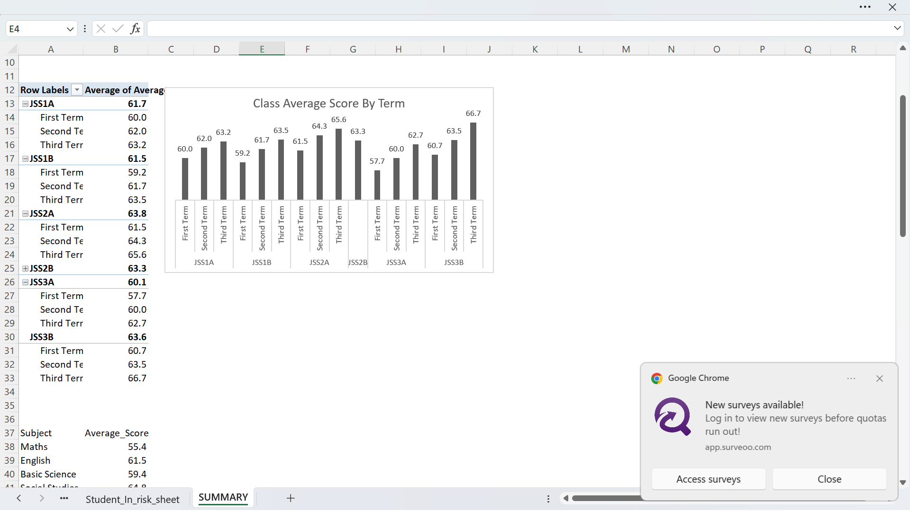

# 📊 Greenfield_school_result_performance_analysis_AkherePaul
This project analyzes Greenfield School Result using Excel. As a data assistant my task is to analyze the performance of six classes for three terms and determine which classes improved each term. I also analyzed the subject to see the one students needed to improve on. This project is also part of my data analytics portfolio
## 🔎Business Questions Answered
- Which class needs the most help?
- Which subject should the school focus on?
- How many student need support?
## 📈Key KPIs
- Total Student
- Total Classes
- Third Term Pass Rate
- Lowest-scoring Subject overall
- Best Third Term Class by Average
- Third Term Students below 50
## ⚒️Toolz Used
- Microsoft Excel
- Pivot Table
- Pivot Charts
- Excel Formulas(COUNTIFS, AVERAGEIFS, AVERAGE, INDEX, MATCH, SUM, UNIQUE)
## 📸Dashboard Preview

## 💡Key Insight
There are 240 students in the school with six classes (JSS1A, JSS1B, JSS2A, JSS2B, JSS3A & JSS3B). JSS1A, JSS1B and JSS3B have a good pass rate (15%) but JSS3B is the class with the best third term passing rate on average (66.7). JSS3A has the lowest pass rate (80%) and the lowest third term average score (62.7 The most difficult subject is Maths with an average score (55.4), more attention should be given to maths. 32 stduent scored below 50, those student need serious supervision. Before any major decision is made, compare the attendance of the student and their course work
## 📁Files in this Repository
[Greenfield_Result](Greenfield_School_Results_Dataset.......AkherePaul.xlsx)
[Summary_screenshot](Greenfield_summary_screenshot.png)
README.md

## 📍Conclusion
Before the numbers was gotten the data was messy with incorrect values about 4, 6 duplicated rows and there was extra space in the name which i had to clean and the classes were also not properly written. i will like you to know that some that 12 student had missing result which i will like you to look into it. Then a new maths teacher should be considered. JSS3A needs extra lesson
